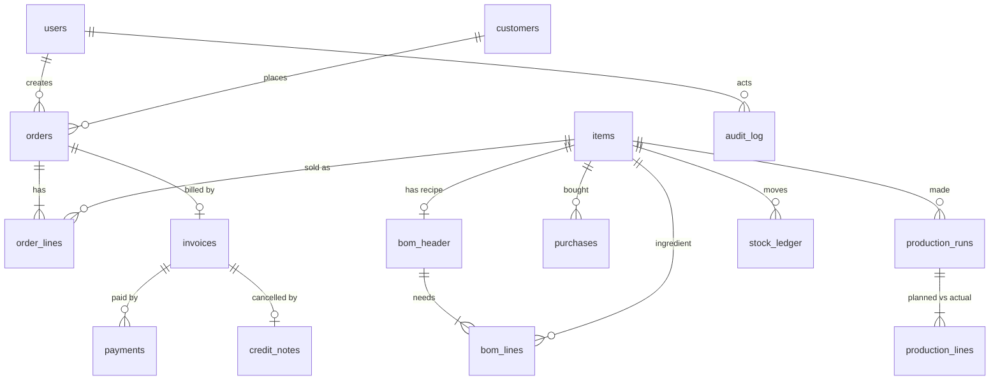

# Design Note

## 1. Data model

`items` holds raw materials, packing materials and finished products (`item_type`), each with a base unit (g, ml or pc).

## 2. How stock is computed
Stock is never typed in. Every change writes one row in `stock_ledger` (`qty_change`, `txn_type`, and the source table and id). **Balance = SUM(qty_change)** for the item.
Sources: opening, purchase, production use, damage, production output, sale (dispatch), and the return from a credit note. `add_movement` refuses any movement that would push a balance below zero. Because there is one write path, the ledger and the balances cannot disagree.

## 3. How BOM consumption is computed
`bom_header` stores the expected packets per batch. `bom_lines` stores the quantity of each material per batch, in base units.
When a production run is saved (`record_run`), in one database transaction:
1. It saves the run with planned output (batches x yield) and actual output.
2. For each BOM line it saves planned vs actual in `production_lines`.
3. It writes ledger rows: material used (negative), damaged (negative, separate type), finished goods (positive).
4. It logs the run in the audit log.

Variance % = (actual - planned) / planned x 100, calculated with `Decimal`. It is flagged when its absolute value is above 3%.
Units: forms accept kg, L or pieces and convert to g, ml or pc before saving.

## 4. Sales flow and tax
Order, admin approval (with stock check), GST invoice, dispatch (stock down), payment. An invoice is blocked if stock is short.
Tax: place of supply equal to Tamil Nadu gives CGST + SGST (half each, odd paisa to SGST); any other state gives IGST. Invoice numbers run by financial year (April to March).
A posted invoice is never deleted. It is cancelled by a **credit note**, which returns stock through the ledger and removes the invoice from reports.

## 5. Costing and valuation
Weighted average purchase rate per base unit (opening stock counts as a purchase). Cost of a run = materials used (including damaged) x average rate + labour + overheads. Cost per packet = run cost / good packets. Margin = selling price - cost per packet.

## 6. Correctness and audit
- Money is stored in paise (integers) and calculated with `Decimal`, never floats.
- Every ledger row links to its source document.
- The audit log records user and time for approvals, quantity edits, invoices, dispatch, payments, cancellations and production runs.
- 16 automatic tests cover stock, GST and the section 5 benchmark.